`TPPSc <https://treegenesdb.org/tppsc>`__ Tutorial Overview
===========================================================

-  TPPSc is a 4 page form that serves as the internal pipeline to submit
   scientific data to our database. This tutorial is meant to show users
   how to successfully use TPPSc to upload data to your database, along
   with how to specifically use certain features, and what to do
   depending on what type of study it is.
-  Our goal is to upload every study we review, but unfortunately that
   is not possible. There are two major sets of data that are uploaded
   with each study. Tree accession information and the scientific data
   that is paired with those trees.
-  What do we mean by “Tree accession”? A tree accession file contains
   the tree ID (or accession number), Latitude/Longitude coordinates
   (WGS 84 in DMS), and the Genus and Species of the tree. This location
   data is then paired with the scientific data such as the recorded
   phenotypes of the trees, recorded SNPs, or even environmental data.
-  In order for a study to be uploaded, both the tree accession file and
   scientific data file need to fulfill the requirements mentioned
   above. If a study only has one of the two files up to standards, an
   email is sent to the first author and corresponding author requesting
   further information on their studies.
-  Once a study is successfully uploaded and viewable on CartograPlant,
   an email is sent to the first author and corresponding author, to let
   them know their data has been uploaded, to invite them to submit to
   Treegenes in the future, and to provide them with a URL to their
   pubically viewable data.
-  Before we go through how to specifically upload a study, I will
   review what to do to curate and find new studies.
-  Big note on TPPSc. It is a user created module and will occasionally
   run into an error or bug here and there. The first thing to do when
   you run into an error that you think is unrelated to your files:
   refresh the page and click save on the bottom. If that doesn’t fix
   the error, promptly let the curation team or the dev team know and we
   will be on a fix as soon as possible!

Finding new Studies applicable for Curation
^^^^^^^^^^^^^^^^^^^^^^^^^^^^^^^^^^^^^^^^^^^

One of the primary locations we use to find studies that are more likely
to have good data is `Dryad <https://datadryad.org/search>`__ since it
is a hosting site for supplemental files. However, we can start anywhere
and also might find most of what we need as files hosted through the
journal where an article is published. Upon searching the Dryad
database, use terms such as “population genetics, plant SSRs, plant
SNPs, plant microsatellites, etc” to attempt and find new studies that
may be applicable for submission. If you think you have found a study
that is applicable, first search (control-F) the title name against the
`TPPS Admin Panel <https://treegenesdb.org/tpps-admin-panel>`__ to
ensure we have not uploaded it so far. Note: search the title of the
study itself rather than the Dryad page for the study

Creating a New `TPPSc <https://treegenesdb.org/tppsc>`__ Submission
===================================================================

Here you have the opportunity to create a new TPPSc Submission and the
chance to continue working on any unfinished submissions. Simply use the
dropdown to select your option and proceed to the next page.

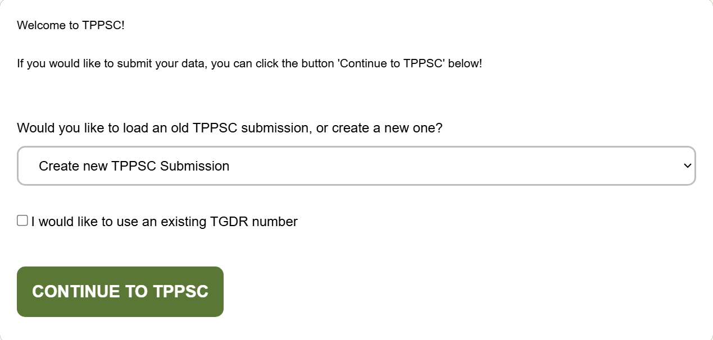

Author and Species Information (Page 1)
~~~~~~~~~~~~~~~~~~~~~~~~~~~~~~~~~~~~~~~

This page requires you to first enter the **publication DOI** and
**dataset DOI** of the study you plan on uploading.

Note: you do not enter the entire link, but only past the colon. For
example, if the full dryad DOI link was
https://datadryad.org/resource/doi:10.5061/dryad.5jn04, enter only
10.5061/dryad.5jn04. If the full pubilcation DOI link was
https://link.springer.com/article/10.1007/s11295-014-0779-0, enter only
10.1007/s11295-014-0779-0.

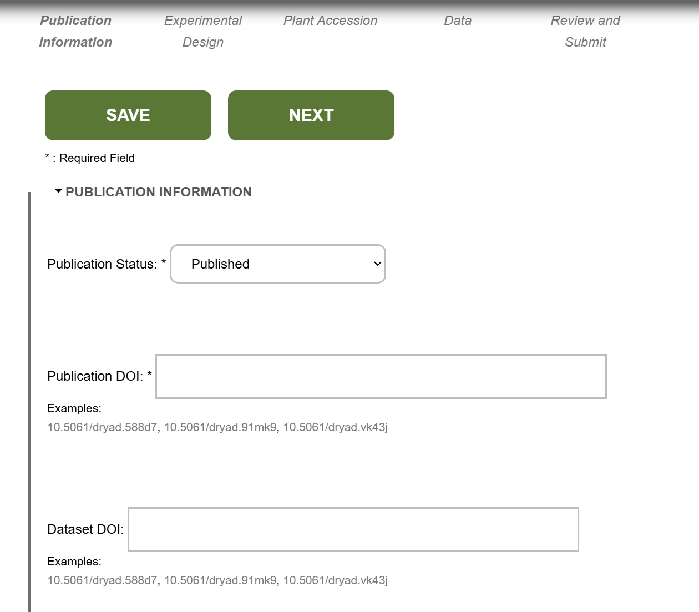

Next, fill in the related information about the study, such as the
**author name, publication year, title, abstract, journal name, and
species name.** You can pull this information directly from the
publication. Remember to pay attention to the format that TPPSc accepts.
Note: get this information from the study page itself rather than the
Dryad or database page

One important thing to check is the **species name**. If the species is
already in the NCBI database, you will see a green box below the entry
showing its **Taxonomy ID**. If not, there may be another name for the
species, a hybrid name may be formatted incorrectly, or the species is
new and has not been added. To find an accepted version of a species
name in the NCBI database, search the name on the `NCBI Taxonomy
dataset <https://www.ncbi.nlm.nih.gov/datasets/taxonomy/>`__ and it will
show you all the names it has for that species. If you still cannot find
the correct name, you may need to check with the curation team. We will
likely need to let Emily know so she can add it to our database.

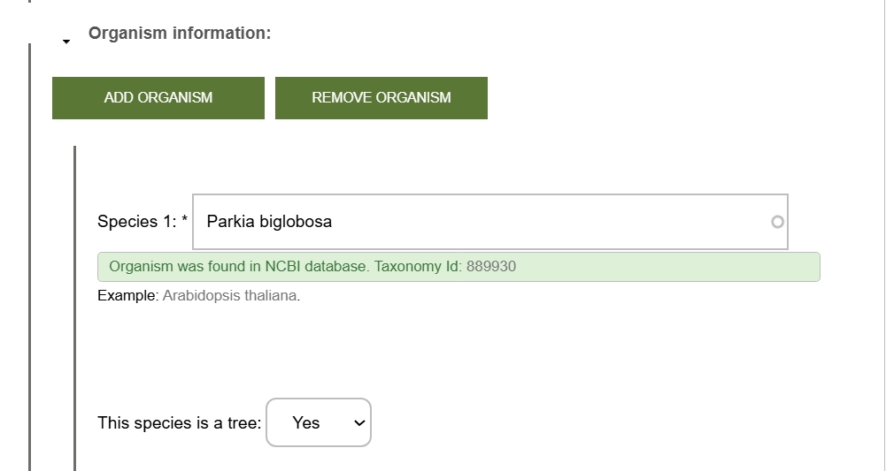

Experimental Conditions (Page 2)
~~~~~~~~~~~~~~~~~~~~~~~~~~~~~~~~

This page consists of two dropdowns that directly affects pages 3 and 4.
The Data Type dropdown is where you chose what type of scientific data
you are uploading, whether it be Genotype, Phenotype, Environment, or
any combination of the 3. The Study Type dropdown is where you chose
what kind of study you are uploading. The options for this field are
Natural Population, Growth Chamber, Greenhouse, Experimental/Common
Garden, and Plantation. The Data Type selection directly affects page 4
and the Study Type selection directly affects page 3.

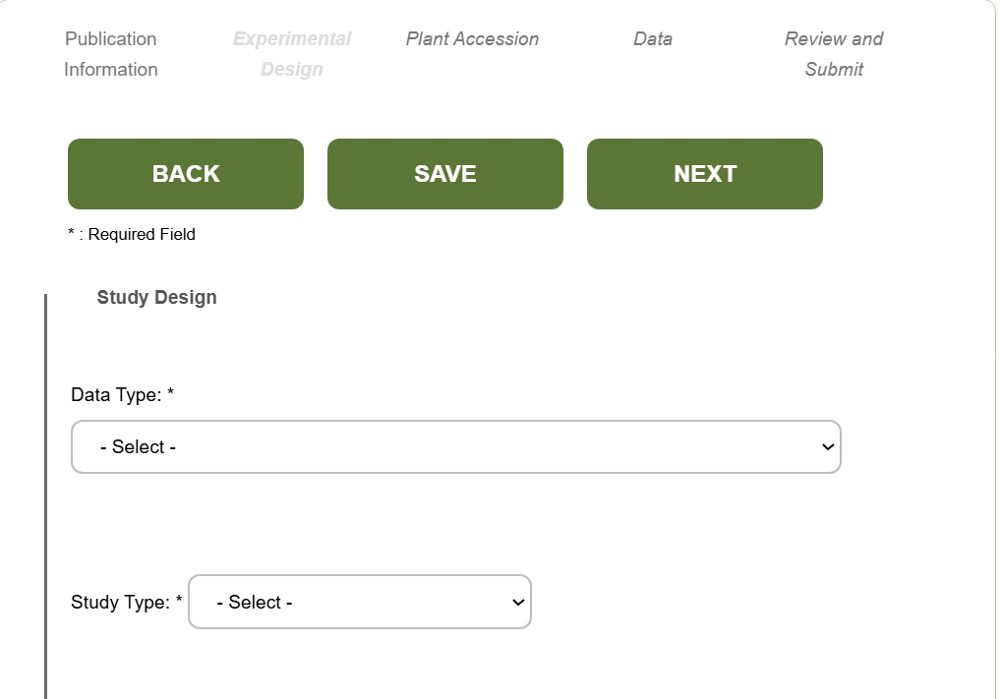

Tree Accession (Page 3)
~~~~~~~~~~~~~~~~~~~~~~~

This page is where we upload the tree location information. We do this
by uploading an Excel file that has all of the location information.
Once the file is uploaded, you then select which columns represent which
required data, where the required data is TreeID, Latitude, and
Longitude (and if there are multiple species, then a column that
represents the genus and species unless you are uploading a separate
accession file for each species). Also be sure to select whether the
tree location information is exact or approximate, and if approximate
then put in the correct approximation information. Approximate would be
considered anything centriod or when you only have population location
information and not exact tree location. An example of a well curated
Tree Accession file is linked
`here <https://treegenesdb.org/sites/default/files/tpps_accession/TGDR001_Tree_Accession_Populus_trichocarpa.csv>`__.

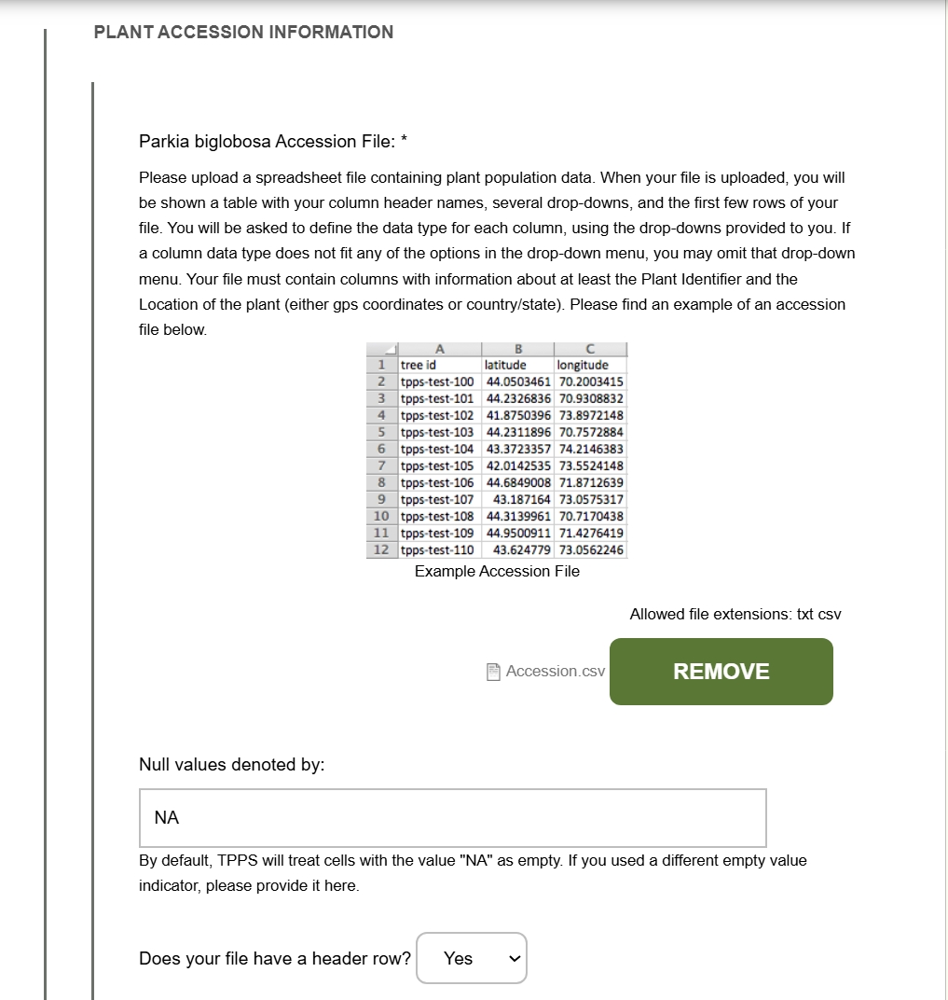

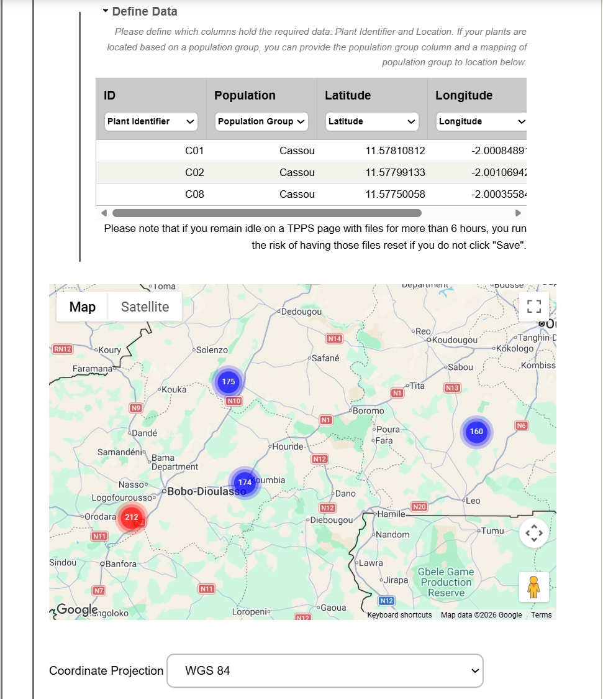

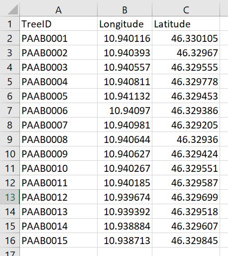

Phenotype, Genotype, and Environmental Data (Page 4)
~~~~~~~~~~~~~~~~~~~~~~~~~~~~~~~~~~~~~~~~~~~~~~~~~~~~

Page 4 will change depending on what you selected for the Data Type
dropdown. If you selected an option with Genotype, then the Genotype
fields will be available. The same goes for Phenotype and Environment.

Phenotype
^^^^^^^^^

When dealing with recorded phenotypes, we first create the phenotypes in
TPPSc and then upload a phenotype file that uses the corresponding
phenotypes. Each phenotype has five different values: **Name**
(human-readable name; must match the column name exactly), **Attribute**
(what the phenotype is describing, such as age, height, amount, etc.),
**Description** (the study’s definition of the phenotype), **Structure**
(the entity describing which part of the plant is being measured), and
**Units**.

To upload your phenotypic data, simply click Add/Remove Phenotype until
the correct number of phenotypes is created, and then fill out the
corresponding metadata for each phenotype. Usually, you will select
phenotypes from the available list. If you cannot find the phenotype you
need, let Emily know so she can add it for you.

After entering the **Name** and a short **Description**, select the
appropriate **Phenotype** from the dropdown menu and choose the correct
**Unit**. Make sure to check the box if it is an environmental
phenotype, such as temperature, day length, precipitation, etc.

When uploading over 20+ phenotypes: a user can enter them all by
creating an Excel file with those 5 columns (name, attribute,
description, structure, and units). NOTE: when uploading a phenotype
metadata file, be sure to use the dropdown boxes for attribute, units,
and structure to ensure that you are using the correct database readable
terms so that the data uploaded can be used in conjuction with other
related phenotype data.

After creating each phenotype, you now need to upload the file. There
are two types of file formats that the phenotype file can be in. File
type 1 has all the phenotypes in their own columns, while file type 2
has 3 total columns: TreeID, phenotype, and value. Either are accepted,
and once uploaded the user will need to chose which columns represent
what, just as done previously. An example of a well curated phenotype
file is
`here <https://treegenesdb.org/sites/default/files/tpps_phenotype/TGDR001_Phenotype_Data_Populus_trichocarpa.xlsx>`__.

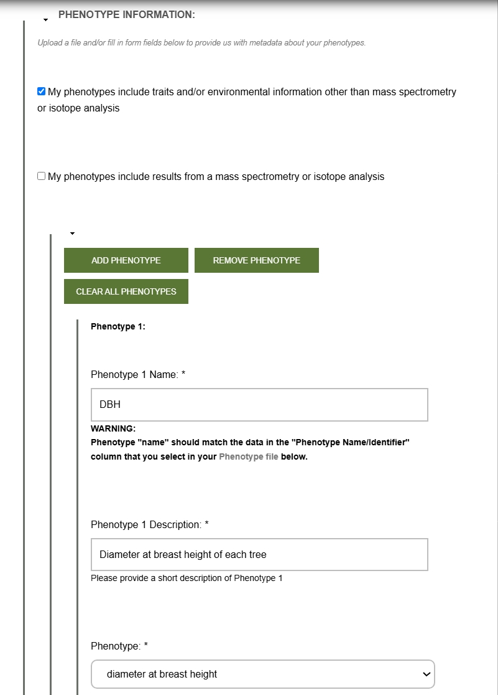

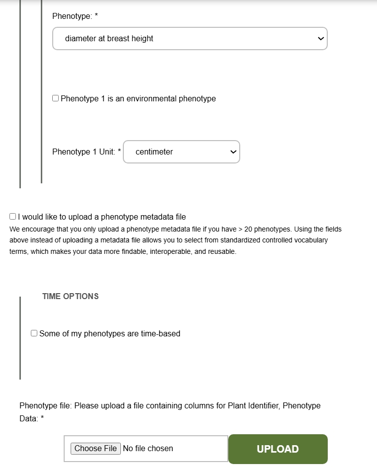

Genotype
^^^^^^^^

The main two types of genotypic data that TPPSc handles is SNP data and
SSR data. The first option in the genotype section requires you to
declare which type of genotypic data will be uploaded. For both
situations, there is a dropdown field that asks if a reference genome is
used.

**SNP:** When dealing with a SNP study, first you select what kind of
SNP you have by selecting which kind of experimental design it is (based
on the article). The possible dropdowns for Experimental Design are GBS,
Targeted Capture, Whole Genome Resequencing, RNA-Seq, and Genotyping
Array.

-  IF GBS is selected, another dropdown for GBS Type appears with
   options RADSeq, ddRAD-Seq, NextRAD, and RAPTURE
-  IF Targeted Capture is selected, another dropdown for Targeted
   Capture Type appears with options of Exome Capture or Other

SNP data will come in either a .csv, .tsv, or .vcf format. To upload the
SNP data, check the SNPs Genotype Assay box for .csv or .tsv files or
VCF for .vcf files. If SNPs Genotype Assay is chosen, you will be
provided with another set of options; Assay Design and SNP Association.
When dealing with SNP Genotype Assays, ideally you should upload the
corresponding Assay Design file. This file contains mapping and quality
information about the SNP file. Additionally, there is an option for the
very important SNP Association file. This file type associated the
phenotypic traits and environmental variables to specific SNP locations.
An example of a SNP Genotype Assay file is
`here <https://treegenesdb.org/sites/default/files/tpps_genotype/TGDR001_Genotype_SNPs_Assay_Populus_trichocarpa.xlsx>`__.

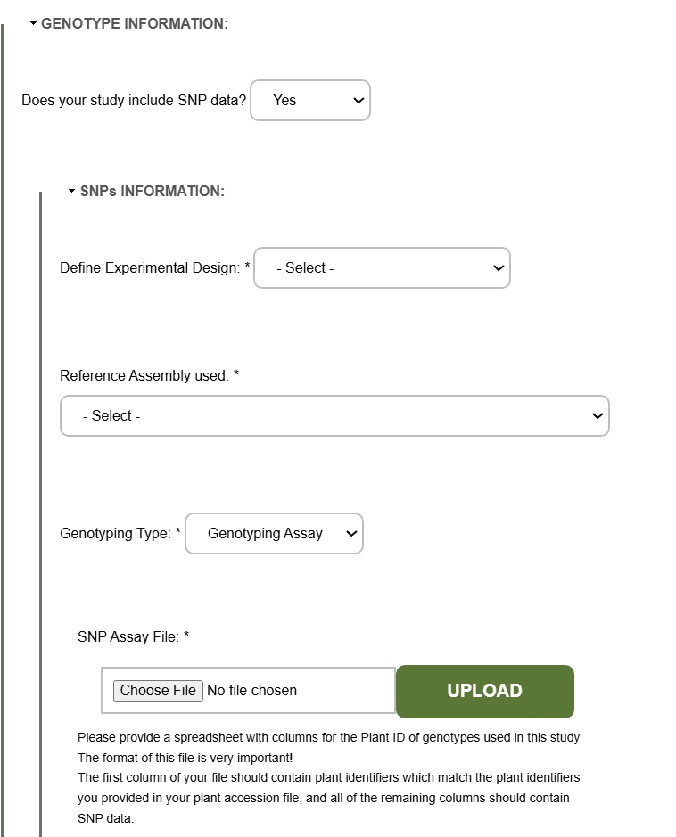

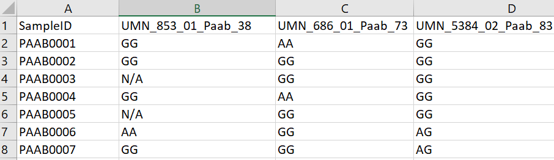

**VCF:** \* When uploading a VCF file there are two options: upload the
VCF from your local device or provide a path to the UCONN-xanadu
cluster. For very large VCF files, sign into the UCONN-xanadu cluster
and direct yourself to /core/labs/Wegrzyn/VCF (cd is the command to
change directory). Once you are within the VCF directory (you can
confirm this by using the pwd command), use the command wget and the
pathname of the file to store a file from the internet on the cluster.
You can obtain the full path to the file by right-clicking the file link
and then clicking Copy Link Address in the dropdown menu. (example: you
might write wget
https://datadryad.org/stash/downloads/file_stream/16442). Your VCF will
now be stored in the cluster. If you wish to rename your file, use the
command mv (example: mv old_name.vcf.gz new_name.vcf.gz). It is
generally best practice to rename your VCF in a way that corresponds to
the study upload to which it will belong (example: for study TGDR001,
you might name your VCF 001.vcf.gz).

-  Return to TPPSc and paste the full path in the corresponding field.
   The full path includes everything above followed by the file
   (examples: /core/labs/Wegrzyn/VCF/populustrich.vcf.gz, or
   /core/labs/Wegrzyn/VCF/new_name.vcf.gz). Next, click on the
   Pre-Validate VCF button. This creates a tripal job on the Jobs page.

-  On the Jobs page, click on the Execute button, and the job should be
   executed immediately.

-  Return to TPPSc and click Review Information and Submit, and continue
   with the submission of the study as usual.

**SNP Assay Design:** These files contain relevant metadata about the
SNP files. The typical fields required in this excel sheet would be:
scaffold name, position, flank sequence, type or marker, and version of
reference genome SNP assay. An example of a well curated Assay Design
file is
`here <https://treegenesdb.org/sites/default/files/tpps_genotype/snp%20data_0.xlsx>`__.

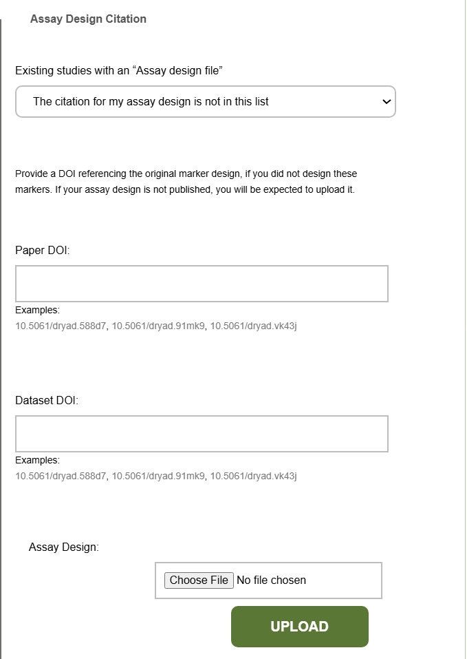

-  For .vcf files, the metadata is already included within the original
   file.

**SNP Association**: One of our main priorities is to upload SNP
Association information to our database. In short, this is an additional
file that confidently makes associations between SNPs and phenotypes,
while giving locations of the SNPs and confidence values as well. An
example of the data we are looking for is below. There is a minimum
amount of data needed for this file to be useful, and any additional
information is denoted with (optional) in the header.

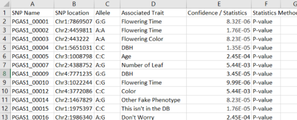

**SSR:** When dealing with an SSR study, first you describe what type of
SSR/cpSSR in the provided drop down. Another field labeled Ploidy then
appears which is very important when uploading the SSR/cpSSR
spreadsheet. If an organism is diploid, then there would be two columns
for each SSR. If the SSR is of haploid chloroplast genes, then there
would be one column for each SSR. Below is a sample data set for SSR
markers where the ploidy would be diploid.

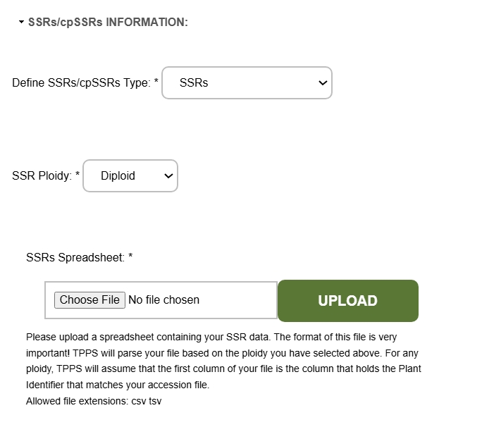

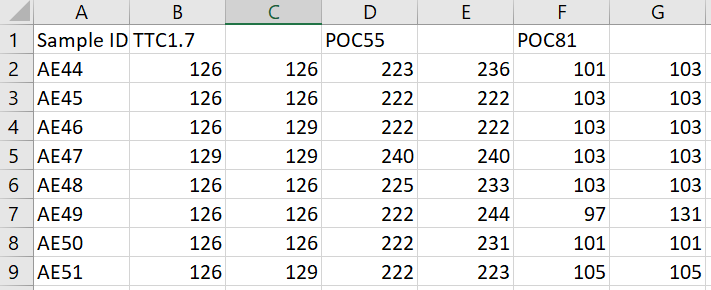

Environment
^^^^^^^^^^^

When dealing with environmental data, there are two types of data.
Either select that you used Environmental Layers indexed by
CartograPlant (Major Soil Types, PET and Aridity, Canopy Height, Land
Cover, Intact Forest Landscapes, and Worldclim v.2), or add layers that
you collected yourself. When adding layers that you collected yourself,
one would add the custom environmental data as a phenotype, and select
the “Phenotype # is an environmental phenotype”. When selected from
layers indexed previously, go through the process of checking what
layers you specifically have. When uploading a custom environmental
layer that is not loaded on our database, ensure to upload the DB URL,
layer name, and the specific parameters used in that layer.

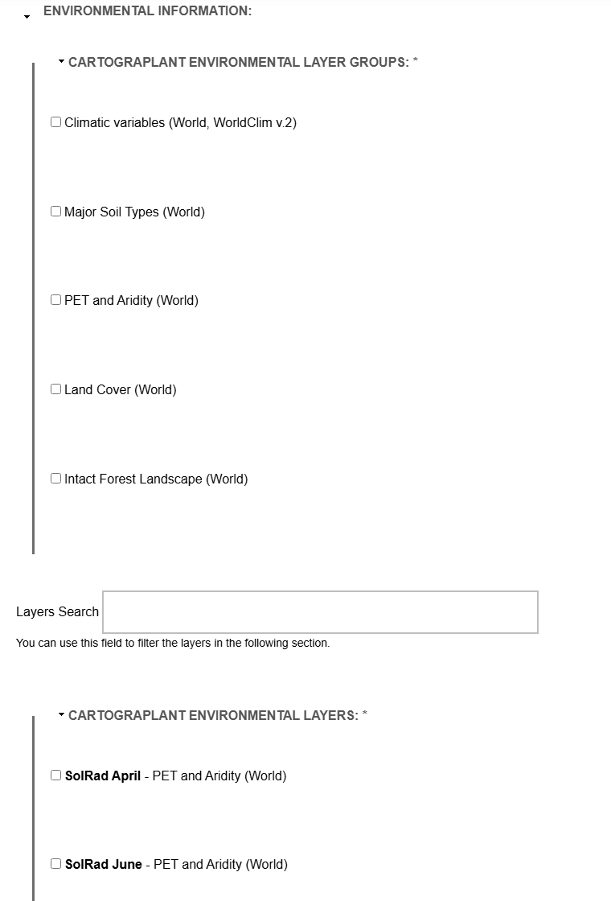

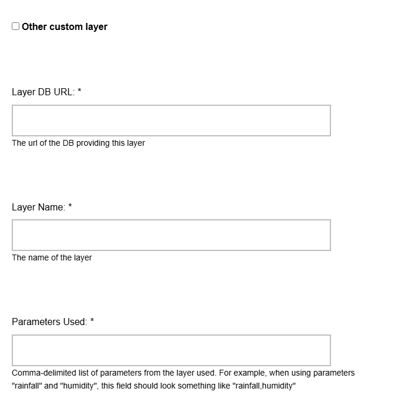

Review Page and Post Submission
===============================

**Species Images**: If on the review page for TPPSc it states that our
database does not have an image for this species, then follow our
`species image curation
protocol <https://gitlab.com/TreeGenes/data-curation/-/blob/master/Species%20Image%20Curation.md>`__
to find an image (if possible). Name the species genus_species.jpg, and
upload the relevant species image information (image + licensing info)
in the fields that populate at the end of the tppsc submission!

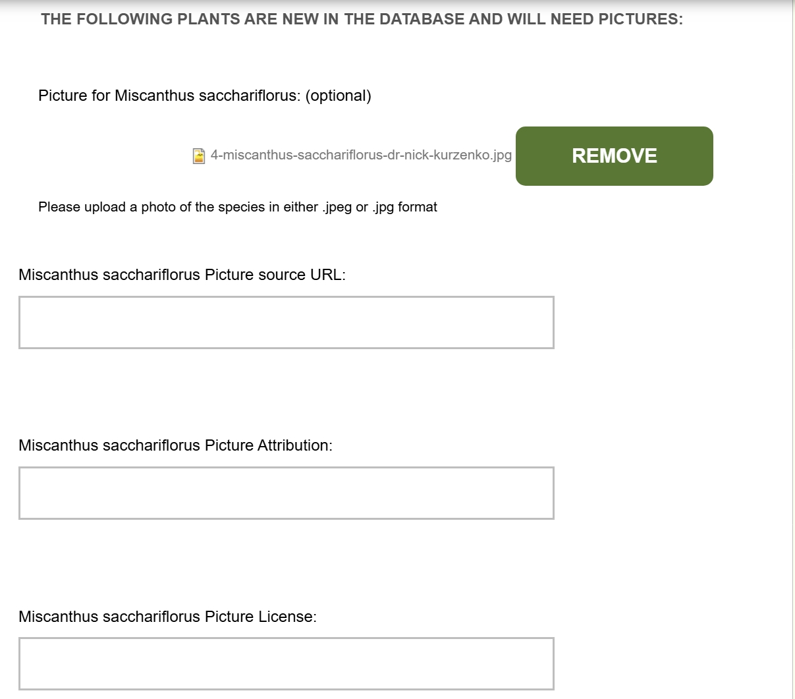

There are a few things to do after submission of the study. First, and
most importantly, approve the study into the database. Head to the
`Admin Panel <https://treegenesdb.org/tpps-admin-panel>`__, find your
study, click on the TGDR accession, scroll down, check the box “This
study has been reviewed and approved” and approve it.

After submitting the study, you will be able to see its TGDR number.
Next, check the TPPS detail page
(https://treegenesdb.org/tpps/details/TGDRXXXX) and the CartograPlant
page by searching for the study’s TGDR number using the filter panel.
Make sure both pages display the study information correctly and that an
appropriate species image is included. Once everything looks good, tag
Meghan on GitHub to review the study. After everything has been reviewed
and confirmed, you can go ahead and approve the study.

Submission Errors and GitHub
----------------------------

When uploading a study, you may not always be able to complete every
step and may encounter errors along the way. This is a common occurrence
and can be addressed through the TreeGenes Curation
`GitHub <https://github.com/orgs/cartograplant/projects/6/views/1>`__.
**Study Loads** is where in-progress and completed studies are recorded.
To add a study, the curator should create a **Task** and add a link to
the curated TGDR so that the curation team can track its progress. Any
errors, concerns, or questions about the study can also be added to the
task if assistance is needed. The **study name** should be entered as
the task name, with any important curation details included in the
description.

You should assign the task to yourself to indicate who is responsible
for the study. Other team members can also be assigned if their
assistance is needed. This is important for both completed studies and
in-progress studies, so that all relevant curation information is
available if another team member needs to assist. Be sure to include any
**corresponding files, screenshots, errors, or other relevant
information** in the task.

Reuploading an already submitted TPPSc study
--------------------------------------------

Say you submit your study successfully but then you notice that you have
some sort of error that you missed when curating. That is okay. There is
a nice way to fix that! Head over to the `Admin
Panel <https://treegenesdb.org/tpps-admin-panel>`__, find and select the
study, scroll down to Change Status, and change the state to
“Incomplete”. From there, you will be able to proceed back to the
treegenesdb.org/tppsc/TGDR### page and edit your study accordingly,
without any big database errors. Once you are finished editing, submit
and approve just as you normally would!
